<div align="center">

# goha

### An open index of Ethiopian AI

A live, source-linked catalogue of the models, datasets, research papers, organizations and benchmarks being built for Amharic, Afaan Oromo, Tigrinya, Ge'ez and other Ethiopian languages.

[](https://goha.enoch.et)
[](https://github.com/Henok-Tekeba/goha/actions/workflows/deploy-pages.yml)
[](https://github.com/Henok-Tekeba/goha/actions/workflows/scrape.yml)
[](https://nextjs.org)
[](https://www.typescriptlang.org)
[](https://github.com/Henok-Tekeba/goha)

[Live site](https://goha.enoch.et) · [Open data](https://goha.enoch.et/api/) · [Contribute](https://goha.enoch.et/contribute/) · [Source](https://github.com/Henok-Tekeba/goha)

</div>

<p align="center">
  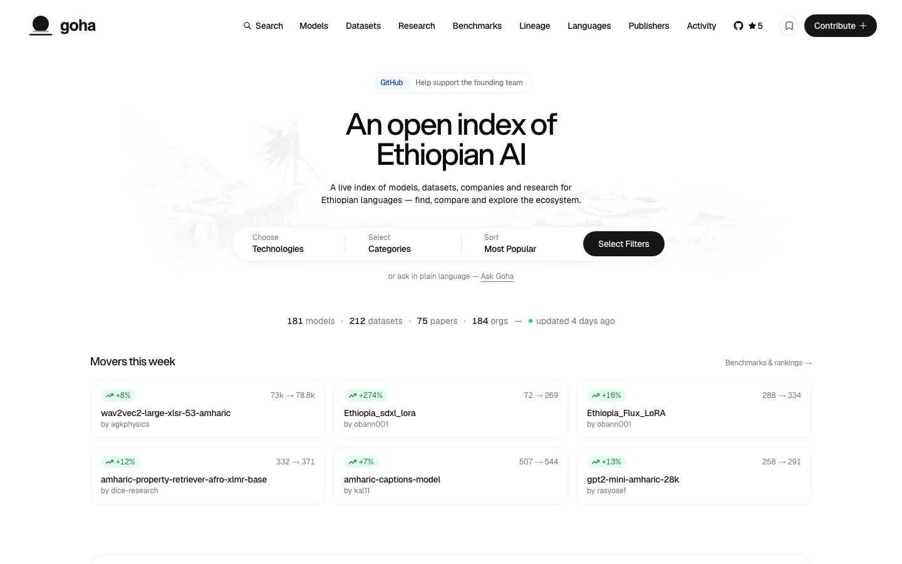
</p>

## Why goha

Ethiopian AI is being built in public, but not in one place. A model lives on Hugging Face, its training data on GitHub, its paper on arXiv, and its evaluation inside a model card or a benchmark repository. The result is visible everywhere and legible nowhere: counts do not reconcile, metrics do not share a test set, and the gaps are invisible until someone looks for them.

goha is the answer to one question: **what exists for Ethiopian languages, who built it, and what is still missing?** It sweeps the public record every day, normalizes what it finds into one catalogue, and derives the views that make the ecosystem usable — search, project pages, comparisons, benchmarks, language coverage and a gap report.

It is deliberately read-only. There is no account to create, no database to operate, and no API key in the browser. The exported site is plain HTML and JSON, rebuilt from committed snapshots.

| | |
|---|---|
| **Product** | **goha** (ጎሃ) |
| **Live** | <https://goha.enoch.et> |
| **Tagline** | An open index of Ethiopian AI |
| **What it does** | Indexes models, datasets, papers, organizations and published evaluations; derives search, benchmarks, lineage, language coverage and gaps from the daily public-record sweep. |
| **Stack** | Next.js 15.5 · React 19 · TypeScript · Tailwind CSS 4 · ECharts 6 · TanStack Query |
| **Auth** | None. No accounts, sessions or passwords; the watchlist is browser-local. |
| **Database** | None. Committed JSON snapshots are the data layer. |
| **Deployment** | GitHub Pages, built by GitHub Actions. OpenNext/Cloudflare scripts exist as an optional path. |
| **Demo access** | Open <https://goha.enoch.et>. No credentials required. |

## A day with goha

1. **Check the pulse.** Open the dashboard for the current counts, index freshness, weekly download movers and latest ecosystem events.
2. **Find an asset.** Search by name, filter by language and task, or ask a plain-language question such as *“Which Tigrinya speech models exist?”*
3. **Open the record.** A project page combines the model card, declared languages, license, base model, download history and published evaluations.
4. **Compare before choosing.** Put up to four models side by side, follow a family tree on the lineage graph, or read the benchmark table for a task and test set.
5. **Act on a gap.** Open a language page or the gap report, save candidates to the local watchlist, and submit a missing record or correction through the guided form.

## Features

- **Daily ecosystem snapshot** — the index refreshes from Hugging Face, GitHub and arXiv every day, so links, counts and evaluations do not go stale.
- **One Project contract** — models, datasets, papers and companies share a predictable record: title, owner, task, languages, downloads, license, model card and evaluations.
- **Search and shareable filters** — language, task, category and sort live in the URL, so a filtered view can be sent to a collaborator.
- **Ask Goha** — a deterministic parser turns plain-language questions into language, task, entity and constraint filters; no LLM, no embeddings, no API calls.
- **Project pages** — model cards, evaluation tables, declared languages, download history, base model and source links in one place.
- **Benchmarks and rankings** — published evaluation results are normalized by task, metric and test set, with per-metric direction and CSV export.
- **Model lineage** — every declared `base_model` is resolved into a family tree with family filters, pan and zoom.
- **Compare models** — overlay download trajectories and diff task, languages, license, size, base model and freshness for up to four models.
- **Language coverage and gaps** — eight language pages and an eight-language × six-task matrix expose empty cells, unmeasured models, unlicensed assets and research-only tasks.
- **Organization footprints** — 184 publishers with aggregated models, datasets, repositories, spaces, top assets and a footprint radar.
- **Activity feed** — a rolling, grouped feed of new models, datasets, papers, milestones and momentum events with a 30-day pulse.
- **Local watchlist** — bookmark any project without an account; saved IDs stay in the browser and never reach a server.
- **Open data API** — data-backed surfaces have static JSON counterparts under `/data/`; the `/api` page documents the files, shapes and caveats.
- **Contribute in a minute** — the guided form builds a structured GitHub issue for a model, dataset, paper, organization, benchmark, correction or feedback.

## Design principles

1. **Every number cites its source.** A count without a link to its methodology is a liability, not a feature.
2. **Aggregate, never invent.** goha normalizes what authors publish; it does not estimate missing metrics or fabricate coverage.
3. **Static by default.** A read-only index does not need a runtime database, a session store or a server fleet.
4. **The scraper is the product.** The interface is a surface over the pipeline; if the sweep is thin, the site should say so.
5. **Amharic is first-class.** Languages, scripts and names are product data, not decoration.
6. **Gaps are part of the product.** An empty cell is a finding. The gap report is as important as the ranking.

## Product screens

### Discovery

| | |
|---|---|
| 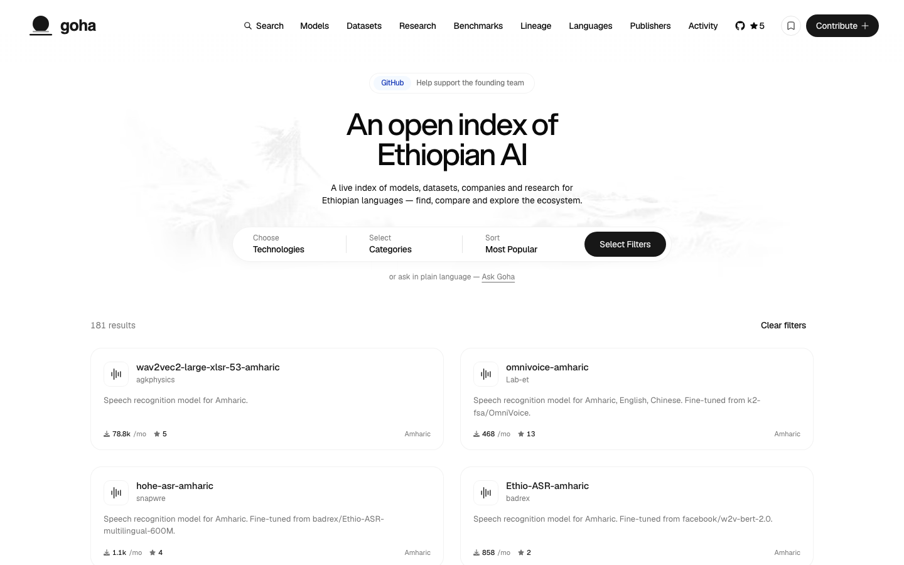 | 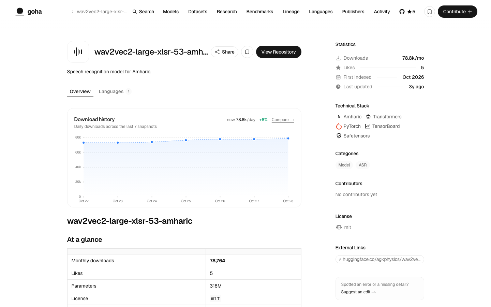 |
| **Browse and filter** — every model, dataset and paper in one catalogue. | **Project detail** — model card, languages, license, base model and download history. |

### Research and benchmarks

| | |
|---|---|
| 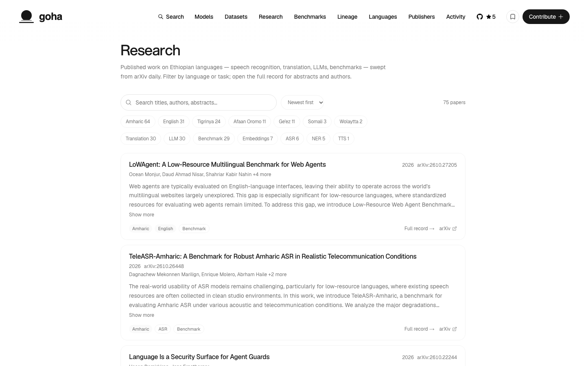 | 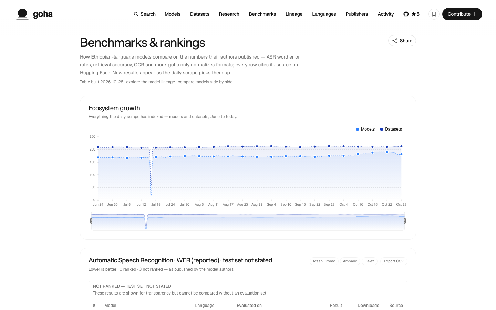 |
| **Research hub** — arXiv papers with authors, abstracts, language and task tags. | **Benchmarks** — published evaluations normalized by task and metric. |

| | |
|---|---|
| 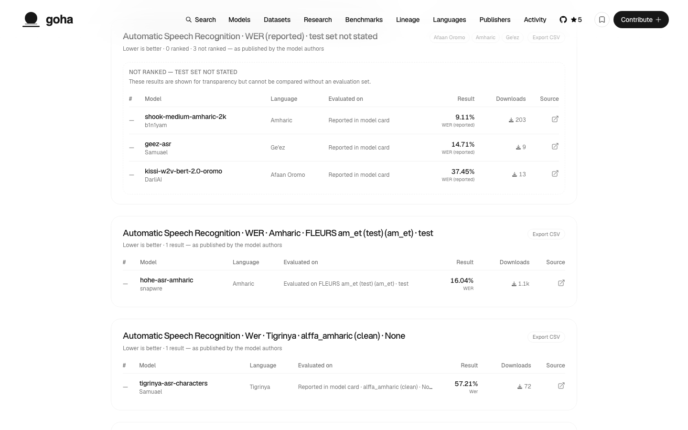 | 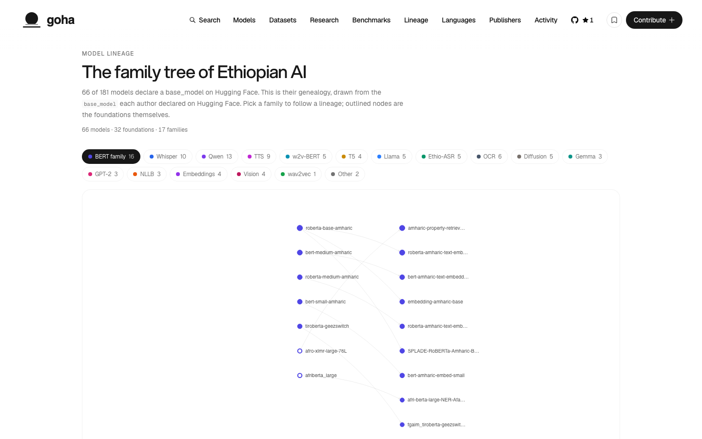 |
| **Comparable tables** — test-set grouping, per-metric direction and CSV export. | **Model lineage** — declared `base_model` relationships as an interactive graph. |

### Workflow

| | |
|---|---|
| 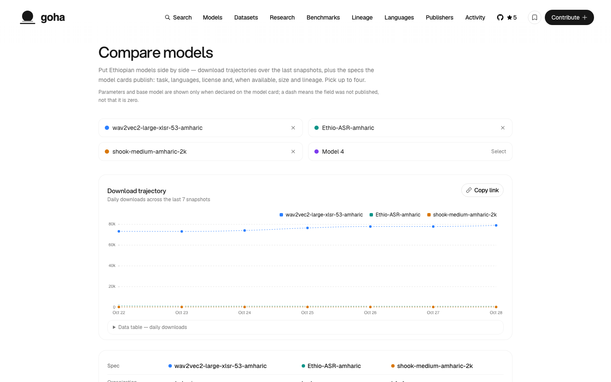 | 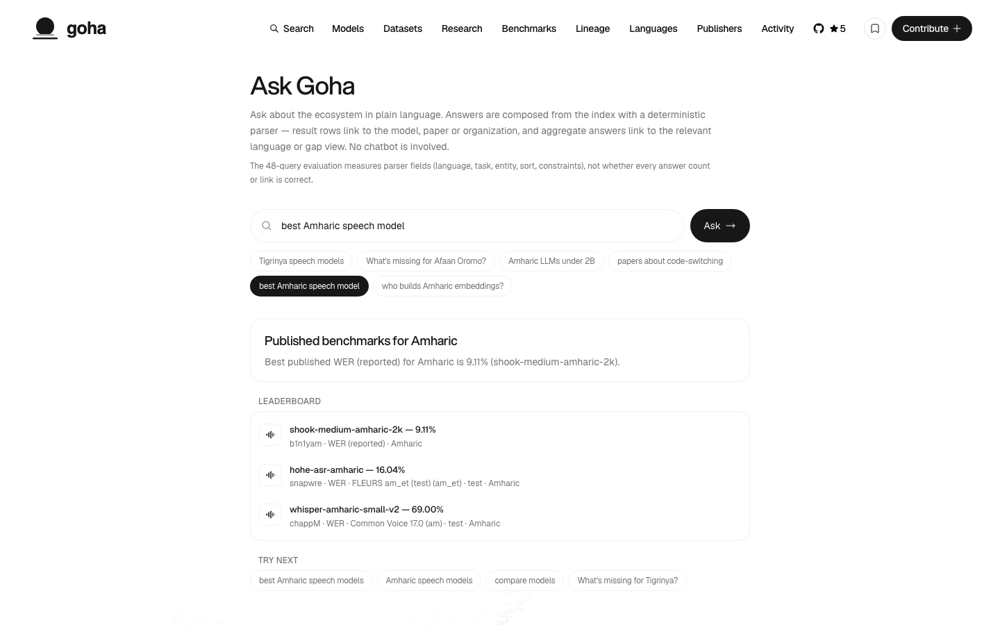 |
| **Compare** — up to four models, overlaid trends and a side-by-side spec diff. | **Ask Goha** — deterministic natural-language search with linked results. |

### Languages, gaps and publishers

| | |
|---|---|
| 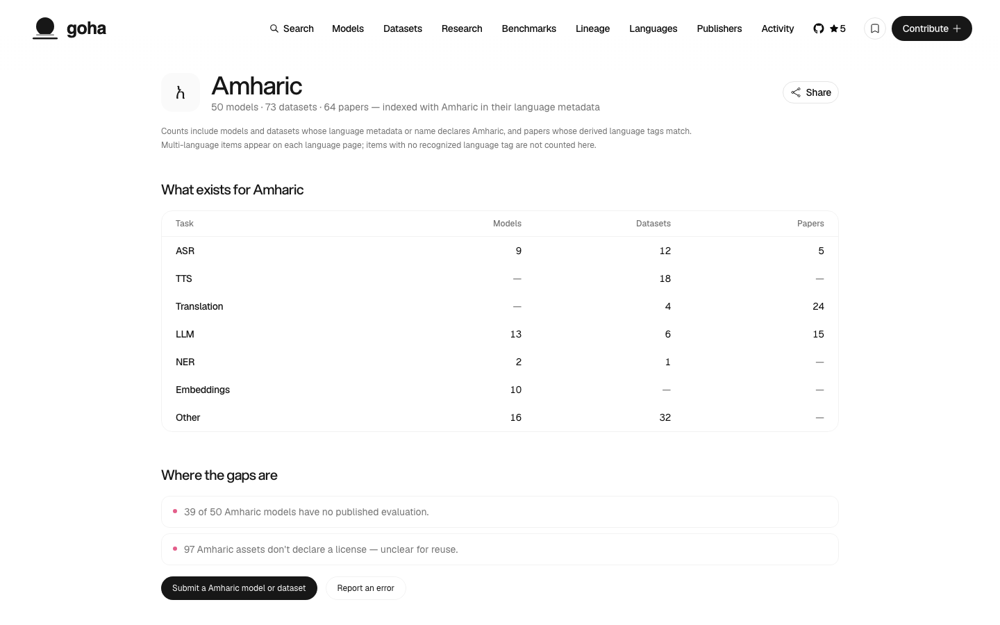 | 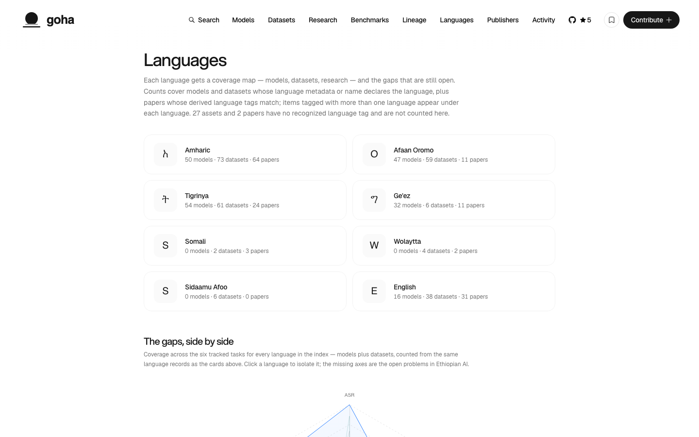 |
| **Language pages** — models, datasets, papers and gaps for one language. | **Coverage map** — six tracked tasks across every indexed language. |

| | |
|---|---|
| 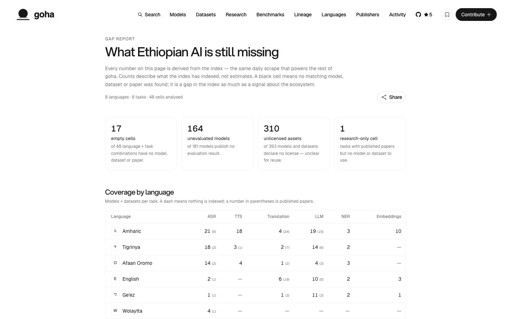 | 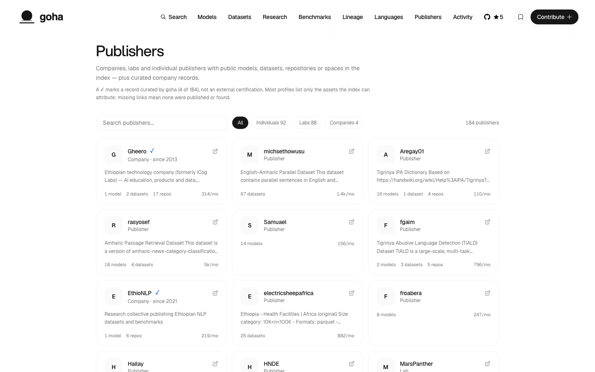 |
| **Gap report** — empty language × task cells, unevaluated models, unlicensed assets. | **Publishers** — 184 organizations with aggregated public footprints. |

### Ecosystem and open data

| | |
|---|---|
| 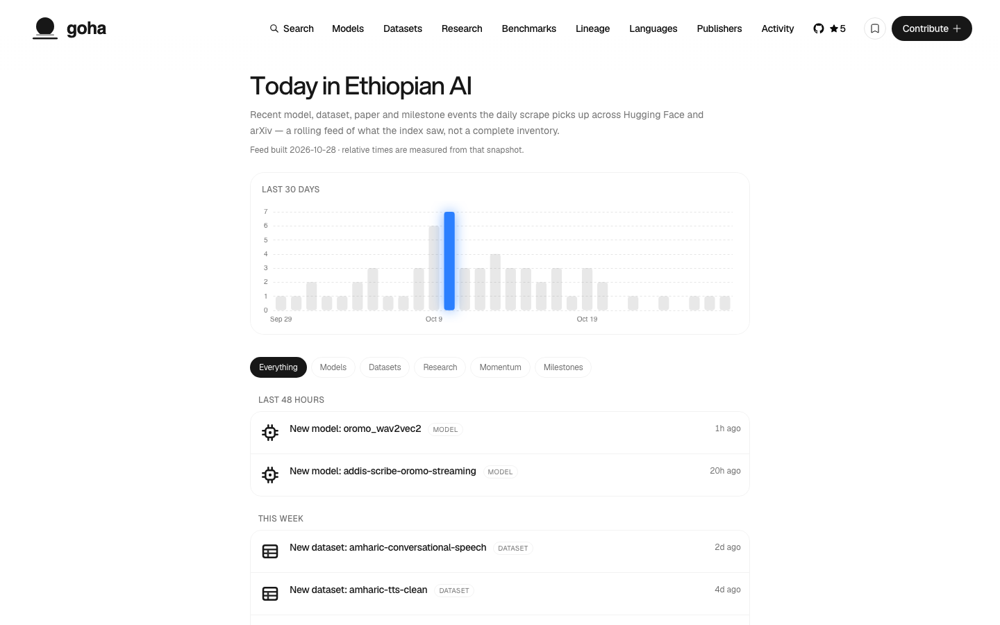 | 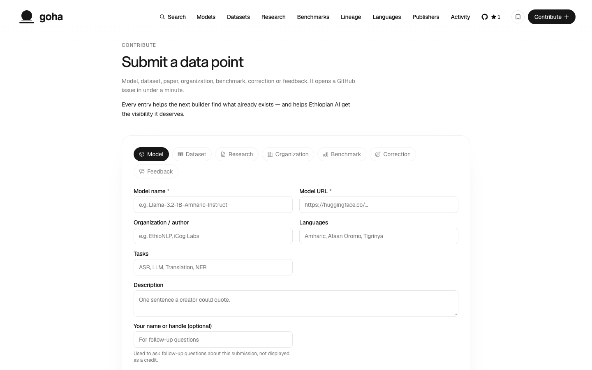 |
| **Activity** — new models, datasets, papers and milestones, grouped by recency. | **Contribute** — a guided form that opens a structured GitHub issue. |

| | |
|---|---|
| 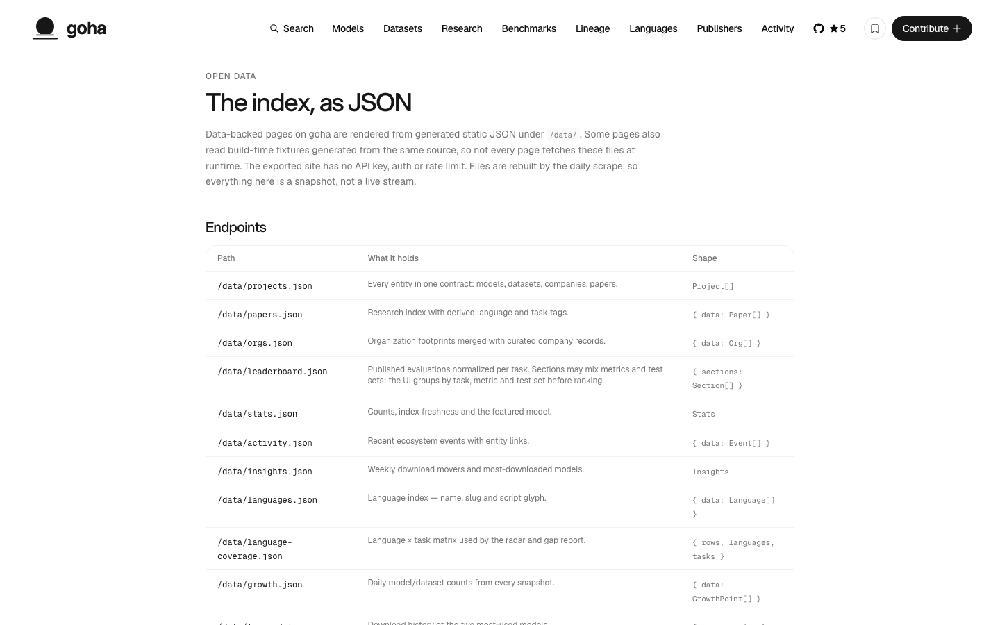 | 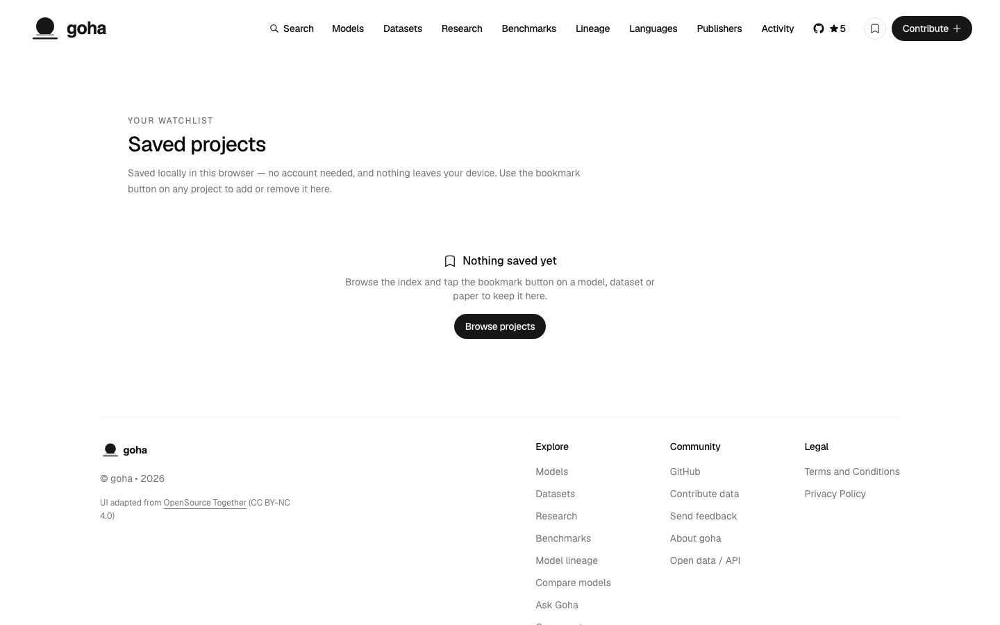 |
| **Open data** — `/data/*.json` endpoints, shapes and honest caveats. | **Saved projects** — a browser-local watchlist with no account. |

Settings, sign-in and onboarding screens are intentionally absent. goha has no account system; the only local state is the watchlist.

## Auth model

goha has no authentication. It is a read-only public index, and the deployed build exposes no account, session or password surface.

```text
┌─────────────┐
│   Visitor   │
└──────┬──────┘
       │
       ├── GET / ────────────────► static HTML + JSON (no cookies)
       │
       ├── Save project ─────────► localStorage["goha:saved"]
       │                           per browser · capped · never sent
       │
       └── Submit data ──────────► prefilled GitHub issue
                                   (GitHub account only, if you have one)
```

- **Account creation** — none. There is no sign-up form, no email verification and no profile.
- **Existing accounts** — none. There is no migration path or account lookup because no accounts exist.
- **Sessions** — no authentication sessions and no identity cookies. Optional GoatCounter analytics is cookieless and aggregate-only.
- **Password handling** — no passwords are collected, stored, hashed or reset.
- **Data isolation** — the watchlist is scoped to one browser origin and never leaves the device. Catalogue data is public and shared read-only.
- **Auth code** — `src/features/auth` is retained from the upstream UI template. `signInWithProvider` throws, `getCurrentUser` returns `null`, and no `/auth/*` route is exported. It is not a working auth system.

If you need accounts, this repository is not the right starting point. The product deliberately avoids them.

## Architecture

```text
┌─────────────────────────────────────────────────────────────┐
│ Browser                                                     │
│ static HTML/CSS/JS · /data/*.json · localStorage watchlist  │
└──────────────────────────────┬──────────────────────────────┘
                               │
┌──────────────────────────────▼──────────────────────────────┐
│ Next.js 15 static export (out/)                             │
│ App Router · React 19 · Tailwind CSS 4 · ECharts 6          │
└──────────────────────────────▲──────────────────────────────┘
                               │ build time
┌──────────────────────────────┴──────────────────────────────┐
│ scripts/build-goha-fixtures.mjs                             │
│ data/db.json + snapshots → data/*.mock.* + public/data/*.json│
└──────────────────────────────▲──────────────────────────────┘
                               │
┌──────────────────────────────┴──────────────────────────────┐
│ scraper/                                                    │
│ Hugging Face API · GitHub API · arXiv API                   │
└──────────────────────────────▲──────────────────────────────┘
                               │ daily at 06:00 UTC
┌──────────────────────────────┴──────────────────────────────┐
│ GitHub Actions → commit data → deploy-pages.yml → Pages     │
└─────────────────────────────────────────────────────────────┘
```

**Production vs local.** Production is the exported `out/` directory on GitHub Pages. There is no production database. Locally, `pnpm dev` reads the committed fixtures. `pnpm dev:mock` starts the MSW-backed mock API for the upstream UI flows; that server is development-only and is not part of the deployed product. The OpenNext/Cloudflare path is optional and not the live deployment.

## Stack

| Layer | Choice | Why it is here |
|---|---|---|
| Framework | Next.js 15.5 App Router | Static export, route-level metadata and build-time data joins. |
| UI | React 19 + TypeScript 5.9 | Typed components and predictable rendering. |
| Styling | Tailwind CSS 4 + Radix primitives | Small, token-driven design system with accessible primitives. |
| Charts | Apache ECharts 6 | Growth, download, radar, lineage and comparison visualizations. |
| Client data | TanStack Query | Cached JSON fetches for interactive ecosystem surfaces. |
| Validation | Zod 4 (jitless under CSP) | Shared form contracts without `unsafe-eval`. |
| Scraper | Node.js ESM | Hugging Face, GitHub and arXiv sweeps with bounded HTTP. |
| Data | Committed JSON | The index is inspectable, diffable and deployable without a database. |
| Build | pnpm 10 | Frozen lockfile installs in CI. |
| Tests | `node:test` + `tsx`, Biome | Fast regression coverage for data, copy, security and workflows. |
| Deploy | GitHub Actions → GitHub Pages | Static hosting with a daily data commit. |
| Analytics | GoatCounter (optional) | Cookieless aggregate page views; disabled when unset. |

## Local setup

Requires **Node 22+** and **pnpm 10**.

```bash
git clone https://github.com/Henok-Tekeba/goha.git
cd goha
pnpm install
pnpm dev
```

Open <http://localhost:3000>. No environment variables, database, Docker or OAuth app are required.

Production build preview:

```bash
pnpm build
python3 -m http.server 4173 -d out
```

Open <http://localhost:4173>. Any static file server works; the export has no server runtime.

## Environment variables

The static site runs without a `.env` file. These values are optional:

```bash
# .env.local — optional
NEXT_PUBLIC_FRONTEND_URL=http://localhost:3000

# Optional: enables cookieless GoatCounter analytics
# NEXT_PUBLIC_GOATCOUNTER_CODE=

# Optional: only when hosting under a subpath
# NEXT_PUBLIC_BASE_PATH=
```

The scraper can read tokens from `scraper/.env`:

```bash
# scraper/.env — never commit
HF_TOKEN=
GITHUB_TOKEN=
```

| Variable | Required | Used by | Purpose |
|---|---|---|---|
| `NEXT_PUBLIC_FRONTEND_URL` | Optional | Next.js metadata | Canonical, Open Graph and Twitter URLs. Defaults to `https://goha.enoch.et`. |
| `NEXT_PUBLIC_BASE_PATH` | Optional | Next.js + asset URLs | Subpath hosting only. Leave empty for the custom domain. |
| `NEXT_PUBLIC_GOATCOUNTER_CODE` | Optional | Layout analytics | Enables GoatCounter. Analytics is disabled when unset. |
| `HF_TOKEN` | Optional / recommended | Scraper | Raises Hugging Face API rate limits. |
| `GITHUB_TOKEN` | Optional / recommended | Scraper | Raises GitHub API rate limits. The workflow maps `secrets.GH_TOKEN` here. |
| `GOHA_BUILD_TIME` | Optional | Fixture build | Pins the snapshot timestamp for deterministic builds. |
| `SMOKE_BASE_URL` | Optional | Live smoke test | Target URL. Defaults to `https://goha.enoch.et`. |
| `SMOKE_RETRIES` / `SMOKE_RETRY_MS` | Optional | Live smoke test | Retry count and delay while Pages propagates. |
| `HEADER_CHECK_URL` | Optional | Header check | Target for `pnpm check:headers`. |
| `NEXT_PUBLIC_API_URL` / `INTERNAL_SERVER_API_URL` | Optional | Local mock only | Retained for the upstream mock API; not needed for the static site. |
| `NEXT_PUBLIC_API_MOCKING` | Optional | Local mock only | Set to `enabled` by `pnpm dev:mock`. Never set in production. |

## Data setup

There is no database. The data layer is a set of committed JSON snapshots plus a build-time fixture step.

```bash
# Refresh the public record from Hugging Face, GitHub and arXiv
cd scraper
npm install
npm start
cd ..

# Rebuild the frontend fixtures and public JSON
node scripts/build-goha-fixtures.mjs
```

The scraper writes `data/db.json`, `data/snapshots/YYYY-MM-DD.json` and the derived data files. The fixture build writes `data/*.mock.*` and `public/data/*.json`, which the site imports or fetches at runtime.

There are no migrations and no seed scripts. The committed fixtures are the seed. To start from a fresh public record, run the scraper again; it overwrites the current state and adds a new dated snapshot.

**Warnings**

- `data/*.json`, `data/*.mock.*` and `public/data/*.json` are generated. Do not hand-edit them for a normal contribution.
- The scraper makes network requests to public APIs and can take several minutes.
- Keep `HF_TOKEN` and `GITHUB_TOKEN` in repository secrets or `scraper/.env`. Never commit them.
- The daily workflow stages only `data/` and generated `public/` directories, then commits the result.

## OAuth and provider setup

There is no OAuth provider, no client ID, no client secret and no redirect URI to register.

The deployed site has no sign-in route. The `src/features/auth` folder is upstream UI scaffolding with a signed-out stub; it is not wired to an identity provider. Forking the site to add accounts would require a different backend and a different security model, not just provider credentials.

## Testing

```bash
pnpm type-check
pnpm lint
pnpm test:mock
pnpm test:ask
pnpm test:counts
pnpm test:ids
pnpm test:classification
pnpm test:leaderboard
pnpm test:copy
pnpm test:activity
pnpm test:security
pnpm test:bookmarks
pnpm test:workflows
pnpm test:artifact
cd scraper && npm test
```

| Command | What it covers |
|---|---|
| `pnpm build` | Runs the data, copy, workflow, security and artifact gates, then builds 1,140 static HTML pages. |
| `pnpm type-check` | TypeScript across the app and scripts. |
| `pnpm lint` | Biome formatting and lint rules. |
| `pnpm test:mock` | 16 MSW handler and fixture tests for the upstream UI flows. |
| `pnpm test:ask` | 48-query Ask Goha parser evaluation; currently 99/99 fields. |
| `pnpm test:counts` | Homepage stats, language coverage and gap-report count reconciliation. |
| `pnpm test:ids` | Source-derived project IDs, aliases and legacy redirects. |
| `pnpm test:classification` | Pipeline-tag and model-task classification. |
| `pnpm test:leaderboard` | Leaderboard grouping, metric direction and real-data invariants. |
| `pnpm test:copy` | Lineage copy and pluralization. |
| `pnpm test:activity` | 30-day pulse bucketing and event ordering. |
| `pnpm test:security` | Markdown sanitization, CSP invariants, CSV formula escaping and jitless Zod. |
| `pnpm test:bookmarks` | Watchlist parsing, caps and toggle behavior. |
| `pnpm test:workflows` | Action pinning, least-privilege permissions and deploy-chain integrity. |
| `pnpm test:artifact` | Export checks: no source maps, mock-session strings or secret-shaped strings; CSP and referrer metadata present. |
| `cd scraper && npm test` | Bounded HTTP responses, timeouts and model enrichment fallbacks. |

Local verification on 2026-11-01: `pnpm build`, `pnpm test:mock`, `pnpm test:ask`, `pnpm test:leaderboard`, `pnpm test:copy`, `pnpm test:activity` and `pnpm type-check` pass. The build emits 1,140 HTML pages.

## Deployment

### GitHub Pages (live)

The production site is a static export served by GitHub Pages at <https://goha.enoch.et>.

1. Push to `main`, run **Deploy to GitHub Pages** manually, or let the daily scrape finish and trigger it through `workflow_run`.
2. `.github/workflows/deploy-pages.yml` installs from the frozen lockfile and runs `pnpm build`.
3. The workflow writes `out/.nojekyll`, uploads `out/` as the Pages artifact and deploys it.
4. A post-deploy job runs `scripts/smoke-test.mjs` against the live URL with retries while Pages propagates.
5. `public/CNAME` keeps the custom domain at `goha.enoch.et`.

Production build command:

```bash
NEXT_PUBLIC_FRONTEND_URL=https://goha.enoch.et pnpm build
```

### Daily data refresh

`.github/workflows/scrape.yml` runs at **06:00 UTC** and on manual dispatch. It installs the scraper, runs its tests, sweeps Hugging Face, GitHub and arXiv, regenerates the fixtures, and commits only `data/` and generated `public/` directories. `HF_TOKEN` and `GH_TOKEN` are repository secrets. The successful scrape triggers a fresh Pages deploy.

### Optional Cloudflare path

`open-next.config.ts`, `wrangler.toml` and the `worker:build`, `worker:preview` and `worker:deploy` scripts describe an OpenNext/Cloudflare Workers path. The live site does not use it. Before using it, update the worker name in `wrangler.toml`, authenticate Wrangler and verify the asset and cache configuration against your Cloudflare account.

## Security notes

- **No sessions, passwords or accounts.** There is no password storage, hashing, reset flow or session cookie to attack.
- **No service keys in the browser.** The exported bundle contains no API keys. Scraper tokens live in GitHub Actions secrets or local `scraper/.env`.
- **Static, read-only surface.** There is no database, server runtime, payment flow or write endpoint in production.
- **Untrusted third-party content.** Model cards, READMEs, issue bodies and markdown are sanitized with the shared `rehype-sanitize` allowlist before rendering.
- **CSP and referrer policy.** `pnpm build` injects a Content Security Policy and `Referrer-Policy: no-referrer` into every exported page. GitHub Pages cannot send custom response headers; `SECURITY.md` documents the Cloudflare proxy path for full headers.
- **CSV exports are guarded.** Leaderboard CSV cells neutralize spreadsheet formulas.
- **Scoped local state.** The watchlist is bounded, parsed defensively and stored only in the visitor's browser.
- **Build artifact checks.** `pnpm test:artifact` fails on source maps, mock-session strings, secret-shaped strings, missing CSP or missing referrer metadata.
- **CI least privilege.** Actions are pinned to full commit SHAs, workflows use narrow permissions, and no fork PR path receives secrets.

Report vulnerabilities privately through [GitHub Security Advisories](https://github.com/Henok-Tekeba/goha/security/advisories/new). Do not open a public issue with exploit details.

## Project structure

```text
goha/
├─ src/
│  ├─ app/                     # Next.js App Router routes and metadata
│  ├─ features/
│  │  ├─ ecosystem/            # leaderboard, lineage, compare, ask, gaps, orgs, lang
│  │  ├─ projects/             # catalogue, project detail, dashboard
│  │  ├─ contribute/           # guided issue builder
│  │  ├─ launch-film/          # 24-second launch film
│  │  ├─ dashboard/            # legacy dashboard surfaces
│  │  └─ auth/                 # upstream UI scaffolding; signed-out stub
│  ├─ shared/                  # layout, UI, hooks, lib, validations
│  ├─ components/evilcharts/   # ECharts chart components
│  ├─ config/                  # site config and security policy
│  ├─ mocks/                   # development-only MSW API
│  └─ fonts/
├─ scraper/
│  ├─ index.mjs                # Hugging Face, GitHub and arXiv sweep
│  ├─ build.mjs                # normalized data outputs
│  ├─ generate-feed.mjs        # activity feed
│  └─ http.mjs                 # bounded HTTP client
├─ scripts/
│  ├─ build-goha-fixtures.mjs  # data → frontend fixtures
│  ├─ check-*.mjs              # artifact, headers, workflow, copy checks
│  ├─ smoke-test.mjs           # live post-deploy smoke test
│  └─ generate-brand-assets.mjs
├─ data/                       # raw snapshots and generated fixtures
├─ public/data/                # client-facing JSON
├─ docs/screenshots/           # README screenshots
├─ .github/workflows/          # scrape, deploy and security workflows
├─ next.config.ts              # static export + base path + image policy
├─ open-next.config.ts         # optional Cloudflare build
├─ wrangler.toml               # optional Cloudflare Worker
└─ package.json
```

## Roadmap and status

**Status:** directory v0.2.0, live and rebuilt daily.

| Area | Status |
|---|---|
| Landing dashboard, search, filters and project pages | Shipped |
| Research hub, leaderboard, lineage, compare and Ask Goha | Shipped |
| Organizations, language pages, gap report and activity feed | Shipped |
| Saved projects, contribution flow and open data API | Shipped |
| Daily scrape, GitHub Pages deploy and live smoke test | Shipped |
| Launch film and security baseline | Shipped |
| Full organization coverage and confirmed language tags | Next |
| Entity linking across papers, models, datasets and orgs | Next |
| Approved submission ingestion and community-submitted badge | Next |
| Semantic search over abstracts and descriptions | Planned |
| Cloudflare Workers, public `/api/v1/*`, Amharic UI | Planned |
| Per-entity OG images, weekly digest and timeline | Planned |

See [ROADMAP.md](ROADMAP.md) for the full sequence and [AUDIT.md](AUDIT.md) for the current quality and reconciliation findings.

**Known limitations**

- The index reflects what the public APIs expose; it is not a claim of completeness.
- The leaderboard aggregates published numbers and does not independently re-run models. Test-set labels and decoding settings vary between sources.
- Some assets have no recognized language tag or no declared license; those are reported on `/gaps` rather than guessed.
- GitHub Pages cannot send custom response headers. The build injects a meta CSP and referrer policy; full headers require a proxy.
- The live counts in this README are a snapshot. The dashboard and `/data/stats.json` are authoritative.

## Repository, source and license

- **Source:** <https://github.com/Henok-Tekeba/goha>
- **Live:** <https://goha.enoch.et>
- **Open data:** <https://goha.enoch.et/api/>
- **Security:** [SECURITY.md](SECURITY.md)
- **Roadmap:** [ROADMAP.md](ROADMAP.md)
- **Contributions:** use the guided form at <https://goha.enoch.et/contribute/> or open an issue with the templates in `.github/ISSUE_TEMPLATE/`.

**License**

- `scraper/`, `data/`, `scripts/` and the generated JSON snapshots are **MIT** (goha). See [LICENSE-MIT](LICENSE-MIT).
- `src/` and `content/` are **CC BY-NC 4.0**, © OpenSource Together. See [LICENSE.md](LICENSE.md).
- Upstream models, datasets, papers and model cards keep their own licenses. The index does not relicense them.

If you reuse the catalogue, cite the upstream source links on each row and keep the goha attribution. Do not present derived counts as upstream claims.

---

<div align="center">

**goha** · ጎሃ · An open index of Ethiopian AI

[goha.enoch.et](https://goha.enoch.et) · [GitHub](https://github.com/Henok-Tekeba/goha)

</div>
